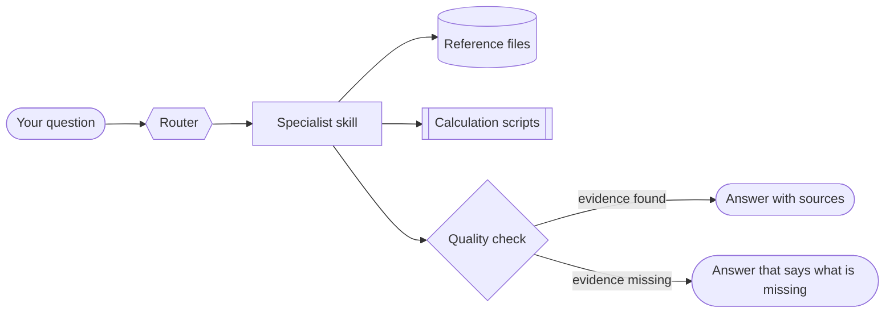

<div align="center">

  <h1>ITAM Enterprise Toolkit</h1>

  <p>
    An enterprise IT asset management plugin designed for native Claude usage.<br/>
   
  </p>

<!-- Badges -->
<p>
  
  
  
  
  
  <a href="https://github.com/Nicholas-Odeh/itam-enterprise-toolkit/commits">
    
  </a>
  <a href="https://github.com/Nicholas-Odeh/itam-enterprise-toolkit/issues/">
    
  </a>
</p>

</div>

<br />

<!-- Table of Contents -->
# Table of Contents

- [About the Project](#about-the-project)
  * [How It Works](#how-it-works)
  * [Tech Stack](#tech-stack)
  * [Features](#features)
  * [Skill Reference](#skill-reference)
  * [Configuration](#configuration)
- [Getting Started](#getting-started)
  * [Prerequisites](#prerequisites)
  * [Installation](#installation)
- [Usage](#usage)
- [FAQ](#faq)
- [Contact](#contact)

<br/>

<!-- About the Project -->
## About the Project

ITAM Enterprise Toolkit is a Claude plugin that gives Claude the working knowledge of a senior IT asset manager. Ask a question in plain English and it loads the right expertise. That covers hardware lifecycle, inventory reconciliation, software licensing, finance, vendors and contracts, ServiceNow, SharePoint, imaging, logistics, secure disposal, risk and audit.

You don't pick a skill or paste a long prompt. The toolkit routes each request, loads only what that request needs, and checks the answer against evidence before you see it.


<!-- How It Works -->
### How It Works
1. **Session starts:** a startup hook loads the router skill, `using-itam-plugin`.
2. **You ask:** the router picks the matching specialist skill, for example `servicenow-itam` for an asset record question.
3. **The skill works:** it reads only the reference files it needs. For exact math it runs a Python script instead of estimating.
4. **Quality check:** the shared operating standard checks every number, date and claim against evidence.
5. **You get the answer:** sources are cited, assumptions are labeled, and anything unproven is called out.


<br/>

---

<!-- TechStack -->
### Tech Stack

<details>
  <summary>Plugin</summary>
  </details>
  <ul>
    <li>23 Claude skills (<code>SKILL.md</code> plus reference files)</li>
    <li>9 slash commands</li>
    <li>1 read-only reviewer agent</li>
    <li>Session-start hook for automatic routing</li>
  </ul>


<details>
  <summary>Scripts</summary>
  </details>
  <ul>
    <li><a href="https://www.python.org/">Python 3</a> (standard library only): matching, serial normalization, depreciation, TCO, SLA credits, RFx scoring, capacity</li>
    <li><a href="https://www.gnu.org/software/bash/">Bash</a>: session-start hook and shared-file sync</li>
  </ul>


<details>
  <summary>Platforms Covered</summary>
  </details>
  <ul>
    <li><a href="https://www.servicenow.com/">ServiceNow</a> HAM, HAM Pro and SAM Pro</li>
    <li><a href="https://www.microsoft.com/microsoft-365/sharepoint">SharePoint Online</a> and Power Automate</li>
    <li>Microsoft Intune, Windows Autopilot and MECM</li>
    <li>Apple Business Manager (ADE)</li>
  </ul>

<details>
  <summary>Integrations</summary>
  </details>
  <ul>
    <li><a href="https://modelcontextprotocol.io/">Model Context Protocol (MCP)</a> connectors by category: ITSM, CMDB, endpoint management, document repository, procurement, finance, HR</li>
  </ul>

---


<!-- Features -->
### Features

- **Automatic routing:** a router picks the right skill for every request.
- **Evidence before claims:** every count, cost, date and license rule cites a source, or is labeled `INFERENCE` or `ASSUMPTION`.
- **No "done" without proof:** it never says reconciled, compliant, wiped or disposed without the evidence in hand.
- **Read-only by default:** any write needs a dry run, a scope cap, a rollback and explicit approval.
- **Grounded in official docs:** ServiceNow guidance cites the ServiceNowDocs repository (Brazil release). SharePoint guidance cites Microsoft's documentation.
- **Exact calculations:** Python scripts handle the math instead of estimates.
- **Built-in reviewer:** the `itam-reviewer` agent returns RELEASE, RELEASE WITH FIXES or BLOCK on any draft.

---

<!-- Skill Reference -->
### Skill Reference

| Area | Skill | Handles |
| --- | --- | --- |
| Foundations | `using-itam-plugin` | Routes each request to the right skill |
| | `itam-operating-standard` | Evidence rules, labels and quality gates |
| Lifecycle | `itam-hardware-lifecycle` | Asset states, onboarding and offboarding, refresh, lost or stolen devices, warranty |
| | `itam-inventory-reconciliation` | Matching ServiceNow, Intune, CMDB and finance lists; exceptions |
| | `itam-software-license-management` | License position, true-ups, reclaim, SaaS, publisher audits |
| | `endpoint-imaging-provisioning` | Autopilot, Intune, MECM, Apple ADE, build standards |
| | `itam-logistics-warehouse` | Receiving, tagging, stockrooms, remote kits, returns |
| | `itam-secure-disposition` | Data sanitization, chain of custody, certificates of destruction |
| Finance | `itam-financial-management` | TCO, depreciation, lease vs. buy, chargeback, forecasts |
| | `itam-acquisition-procurement` | Purchase requests, catalog, RFP scoring, PO-to-receipt |
| | `itam-vendor-contract-management` | Contract obligations, SLA credits, scorecards, renewals |
| Platforms | `servicenow-itam` | HAM and SAM Pro, asset-CI sync, stockrooms, reclamation, queries |
| | `sharepoint-itam-records` | SharePoint how-to, evidence libraries, metadata, retention |
| Governance | `itam-program-governance` | Strategy, maturity, roadmap, RACI, policies |
| | `itam-risk-controls-audit` | Risk register, control testing, audit readiness |
| | `itam-process-improvement` | DMAIC, process maps, root cause |
| | `itam-change-request` | CAB-ready change records with rollback |
| | `itam-status-report` | Status reports with evidence-based RAG |
| | `itam-capacity-planning` | Stock levels, imaging throughput, staffing, backlog |
| | `itam-data-analysis-reporting` | KPIs, data quality, dashboards |
| | `itam-spreadsheet-models` | Audit-ready workbook designs |
| | `itam-automation-scripting` | PowerShell, Python and Graph with safe-write rules |
| | `itam-sop-documentation` | SOPs, work instructions, policies, runbooks |

---

<!-- Configuration -->
### Configuration

The toolkit works out of the box using general good practice, and labels its assumptions. However, to tailor it to your organization, fill in these files. Leave unknown values blank rather than guessing.

| File | What to set |
| --- | --- |
| `templates/company-profile.md` | Systems, lifecycle names, refresh cycle, finance thresholds, approval limits |
| `skills/itam-hardware-lifecycle/references/asset-data-model.md` | Your lifecycle states mapped to the canonical model |
| `skills/itam-financial-management/references/finance-policy.md` | Depreciation method, useful lives, cost centers |
| `skills/itam-software-license-management/references/publishers/_template.md` | One copy per software publisher |
| `skills/sharepoint-itam-records/references/retention-schedule.md` | Retention periods for evidence |
| `skills/servicenow-itam/references/instance-profile-template.md` | ServiceNow release, licensed apps, custom fields |
| `.mcp.json` (copy of `.mcp.json.example`) | Optional live connectors (see `CONNECTORS.md`) |


<!-- Getting Started -->
## Getting Started

<!-- Prerequisites -->
### Prerequisites

- Claude Code, or a Claude workspace that accepts plugin uploads
- Python 3, to run the calculation scripts
- Optional: MCP connectors for your ITSM, CMDB, endpoint or document systems

<!-- Installation -->
### Installation

Upload the plugin zip where your Claude workspace adds plugins, or install the folder in Claude Code. Then turn the plugin on and start a new chat.


<!-- Usage -->
## Usage

Ask in plain English. The router picks the skill.

```text
How do I change the Assigned to user on an asset in ServiceNow?
Reconcile these two exports and list the exceptions.          (attach both files)
The ITAD certificate lists 180 serials; our manifest has 200. What can we close?
```

Or use a command:

| Command | What it produces |
| --- | --- |
| `/reconcile` | Reconciliation of two or more asset extracts, with exceptions |
| `/audit-ready` | Audit-readiness check and evidence gaps for an ITAM area |
| `/refresh-forecast` | Hardware refresh volumes and cost from an asset extract |
| `/license-position` | Effective license position for a publisher or product |
| `/itam-sop` | Audit-ready standard operating procedure |
| `/itam-change` | Change request with dry-run evidence, risk and rollback |
| `/itam-status` | Status report with evidence-based RAG |
| `/itam-capacity` | Capacity check against planned demand |
| `/itam-runbook` | Operational runbook with failure actions and escalation |


<!-- FAQ -->
## FAQ

- Do I need to tell Claude which skill to use?

  + No. The router reads your request and loads the right skill automatically.

- Our ServiceNow instance isn't on the Brazil release. Is the guidance still valid?

  + Mostly, but check release-specific details. Behavior that differs by release is marked `VERIFY`, and `skills/servicenow-itam/references/sources.md` explains how to re-check citations for your release.

- Why did it say it couldn't confirm something?

  + It won't claim something is reconciled, compliant or disposed without evidence. It tells you what is missing and how to get it.


<!-- Contact -->
## Contact

Nicholas Odeh

Project Link: [https://github.com/Nicholas-Odeh/itam-enterprise-toolkit](https://github.com/Nicholas-Odeh/itam-enterprise-toolkit)

